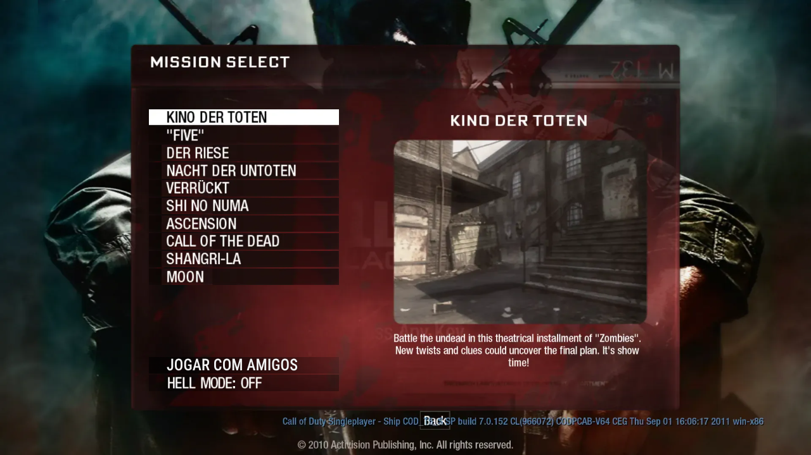
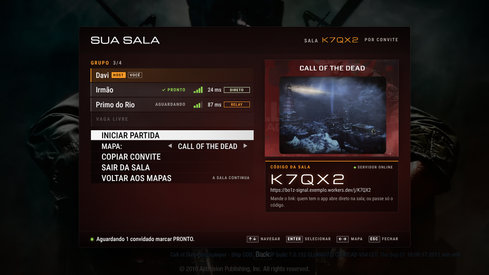
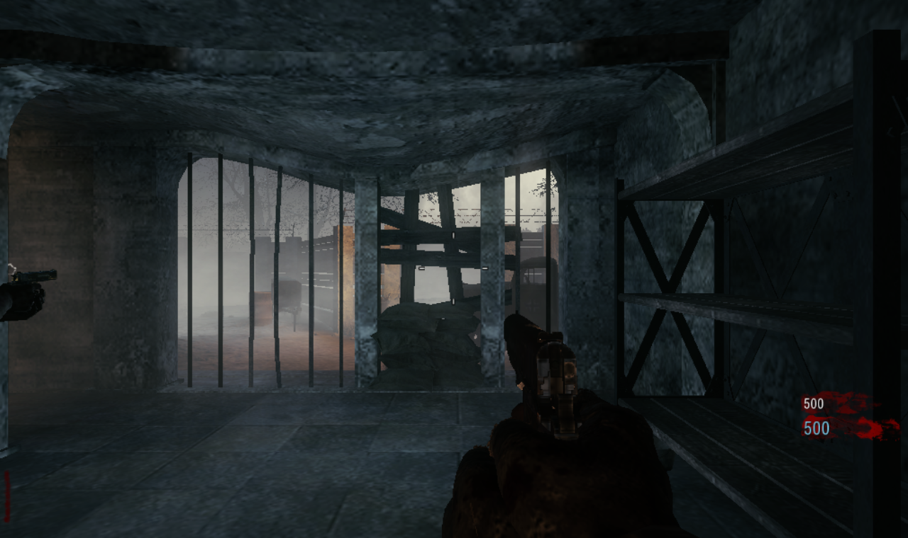

# BO1 Zombies Co-op

**Black Ops 1 Zombies with your friends. Send a link, they click, you play.**
Mac · Windows · Browser (Chrome/Edge) · up to 4 players · peer-to-peer



[vel.gg](https://vel.gg/bo1z/) ported the Black Ops 1 Zombies engine to WebAssembly, and it runs right in a browser.
That port is single-player only. This project adds **real online co-op** on top of it, with no server to rent and no
port forwarding. The game itself isn't modified on disk, and no game files are included here.

| | |
| --- | --- |
|  |  |
| Native-looking lobby: party, ping, direct/relay badge, ready, map art | Guest in the host's game (Nacht), both players on the HUD |

## Features

- **One link to join.** The host creates a lobby and shares `https://<invite-server>/j/CODE`. The friend's app opens
  straight into the lobby through the `bo1z://` link, or they can type the 5-letter code.
- **Peer-to-peer WebRTC.** Game traffic goes directly between players, so latency is your real network ping. Cloudflare
  TURN is the fallback when NATs refuse a direct connection.
- **Lobby built into the game's own menu.** It adds a "play with friends" item on the map select screen, shows a party
  list with ping bars and DIRECT/RELAY badges, lets the host pick a map, has guests mark ready, and starts everyone
  together.
- **Every map the port ships:** Kino der Toten, "Five", Der Riese, Nacht der Untoten, Verrückt, Shi No Numa,
  Ascension, Call of the Dead, Shangri-La, Moon.
- **Built for long sessions:**
  - ICE restarts and reconnects on their own.
  - A guest who drops for up to 40 s gets the same server slot back.
  - The OS can't suspend the app while a lobby is open.
  - Background throttling is off.
- **LAN / Tailscale mode** connects by IP over UDP if you'd rather not use the invite server.
- **Browser extension (experimental)** gives the same co-op on vel.gg in Chrome/Edge (`browser/`).

> The UI text is currently in Portuguese (pt-BR); English UI strings are on the roadmap.

## Quick start

### 1. Get the app

```bash
git clone https://github.com/Daviqr1/bo1z-macos && cd bo1z-macos
npm ci
./build.sh                      # macOS: builds ~/Applications/BO1 Zombies.app
./scripts/package-windows.sh    # Windows: dist/BO1-Zombies-win64.zip (portable, runs on any machine)
```

On Windows, unzip and run `BO1 Zombies.exe`. If SmartScreen appears, click *More info → Run anyway*. The game data
downloads from vel.gg the first time you open a map.

### 2. Deploy your invite server (once, free)

The invite server only introduces players to each other: lobby codes, names, and the WebRTC handshake. It runs on a
free Cloudflare account:

```bash
./scripts/deploy-signal.sh      # logs into Cloudflare, deploys signal/, writes the URL into the app
```

Rebuild the app afterwards so the URL is baked in. TURN for hard NATs is optional (see [signal/README.md](signal/README.md)).

### 3. Play

1. Open the map select screen and choose *play with friends*, then *create lobby*.
2. Copy the invite and send it to a friend (WhatsApp, Discord, anything).
3. Your friend clicks it, the app opens, and they're in your lobby. They mark ready.
4. Pick a map and start. Both games load and you're in the same match.

## How it works

The web port has no network code you can reach. The engine only talks to itself through **loopback packet rings** in
its 2 GiB shared WebAssembly memory. Co-op is built by tapping those rings:

- **Ring bridge** ([app/coop/netbridge.mjs](app/coop/netbridge.mjs)): a dedicated Worker polls the rings every ~1 ms. It
  reads what the engine sends and injects remote packets with a write-then-CAS publish, so it never tears a packet the
  engine is writing.
- **Host:** each guest gets its own ring, so the host's real server sees a new "client address" per guest.
- **Guest ("shadow" strategy):** the guest loads the same map with a local server, which supplies the zombies-mode
  data, anim trees and configstrings. It then connects to the host. A one-instruction wasm patch (`G1`, gated by the
  wasm's sha256) makes the client accept only the host's snapshots, and the local server is paused.
- **Transport:**
  - A hidden window runs WebRTC with two DataChannels: `game` (unordered, no retransmits, i.e. UDP semantics) and
    `ctl` (reliable, for ping and the lobby).
  - The signaling server is a Cloudflare Worker with one Durable Object per room.
- Ring addresses are found by scanning the wasm's name section at runtime, and every patch checks hashes and falls
  back to solo play if anything doesn't match.

Deep dives: [docs/COOP-ARCH.md](docs/COOP-ARCH.md) (architecture and interfaces) and
[docs/COOP-STATUS.md](docs/COOP-STATUS.md) (real-engine findings), both in Portuguese.

## Tested

- 147 automated tests (`npm test`) cover:
  - ring races under the recorded frame cadence;
  - the bridge, wasm scan and patch;
  - the lobby;
  - the signaling room logic plus a real WebSocket server;
  - WebRTC between two real Electron windows.
- End-to-end runs with **two real engines**: lobby → map → both in game for minutes, over UDP and over WebRTC
  ([tools/coop-e2e.mjs](tools/coop-e2e.mjs)).

## Repository map

| path | what |
| --- | --- |
| `app/` | Electron app (main, preload, co-op session, ring bridge, wasm scan/patch) |
| `app/net/` | WebRTC + signaling client (hidden window) |
| `app/lobby/` | in-game lobby UI |
| `signal/` | invite/signaling server (Cloudflare Worker + Durable Object; `dev-server.mjs` for local) |
| `browser/` | Chrome/Edge extension (experimental) |
| `tools/`, `sim/`, `test/` | E2E driver, packet-ring simulator, tests |

## Disclaimer

This is an unofficial fan project, not affiliated with Activision or vel.gg. Call of Duty and Black Ops are trademarks
of Activision Publishing, Inc. This repository and its builds contain **no game files**; the game is loaded from
vel.gg at runtime, like a browser does. If you hold rights and have a concern, please open an issue.

---

🇧🇷 Projeto brasileiro. Feito para jogar com o irmão e aberto para todo mundo.
